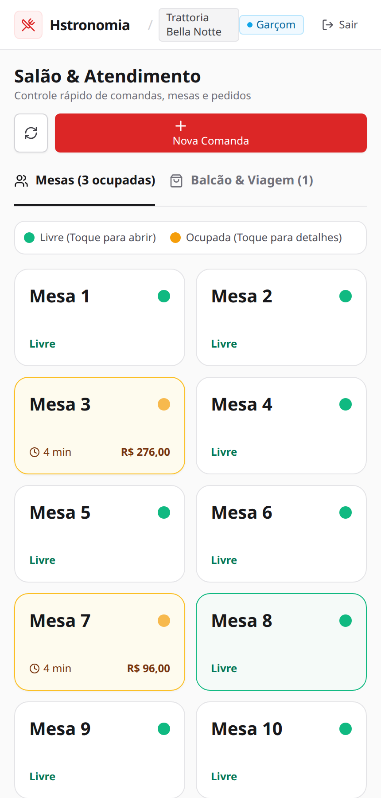
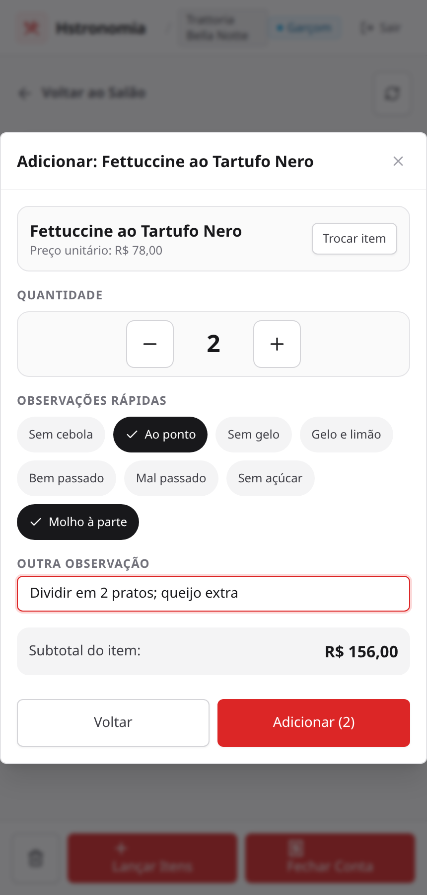
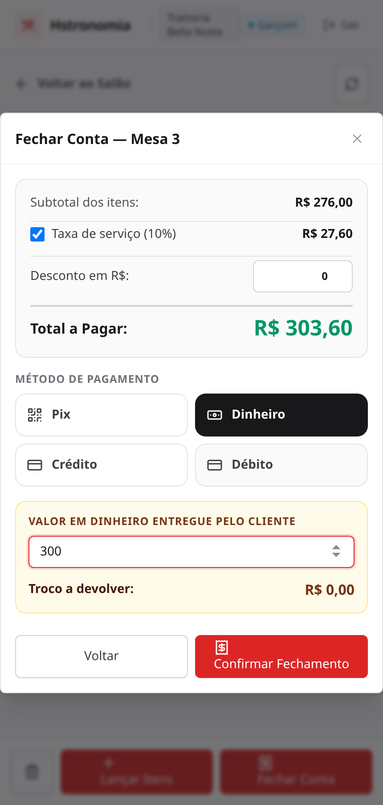
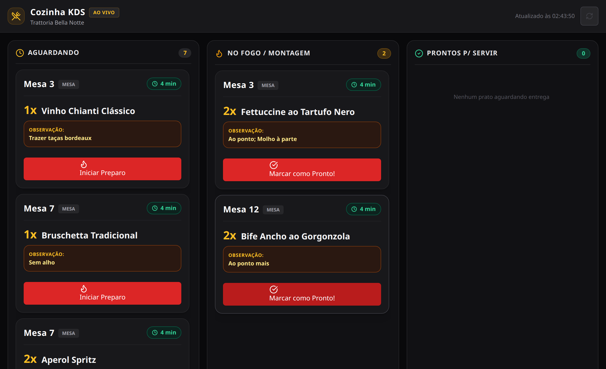
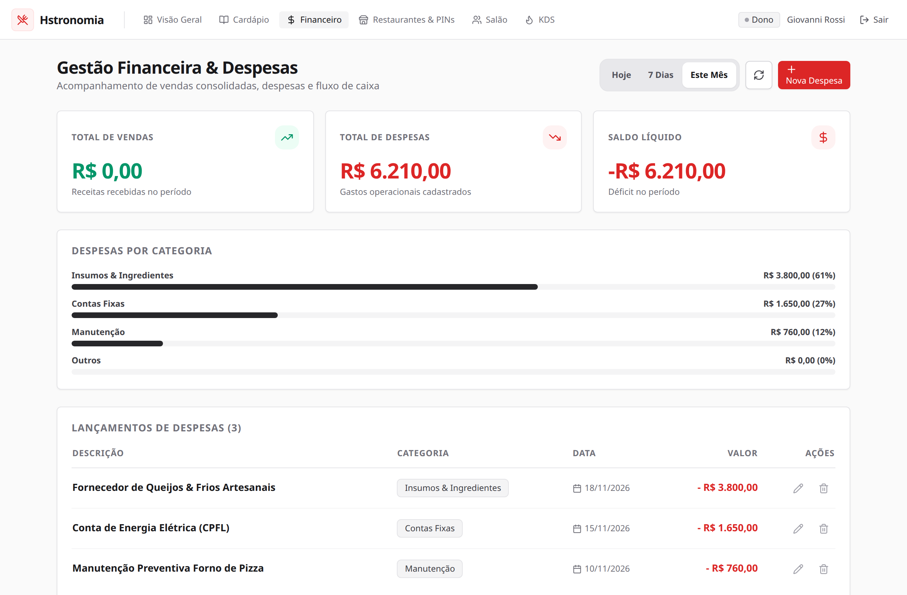
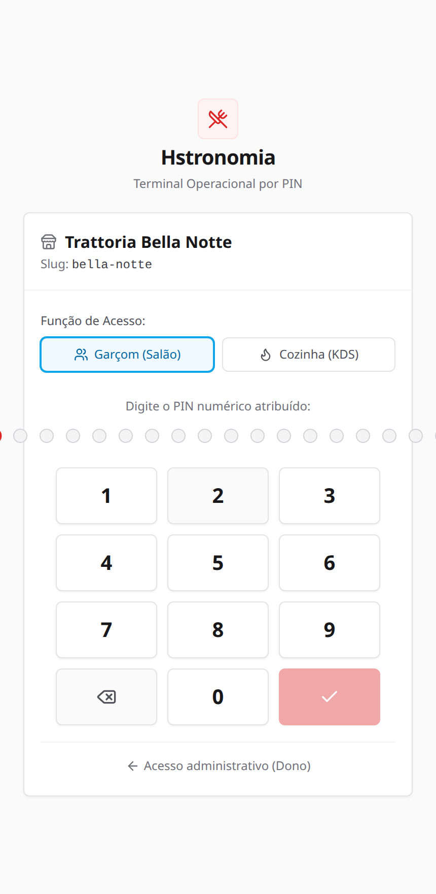
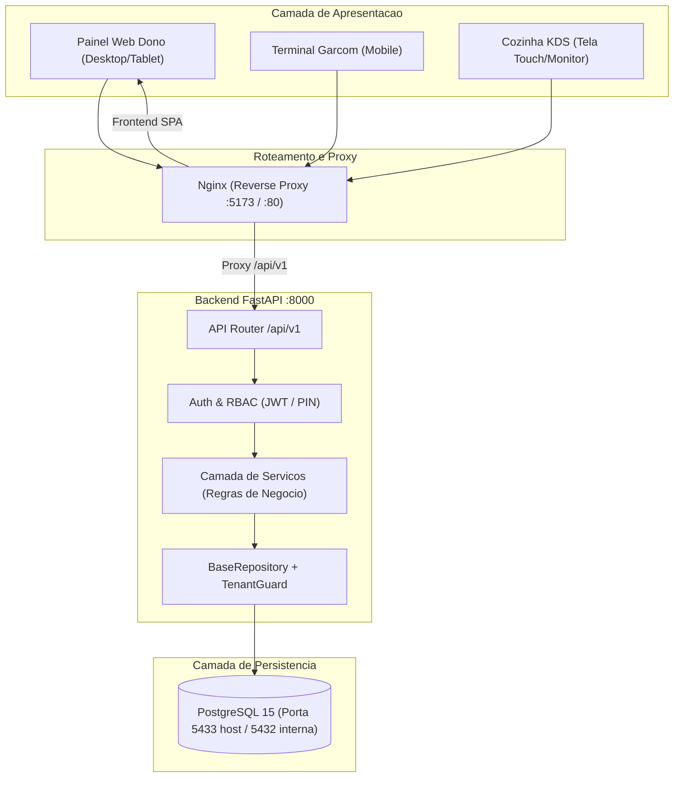

# Hstronomia

Sistema operacional completo de gestão gastronômica multi-tenant, unificando retaguarda administrativa, atendimento de salão mobile-first e display de cozinha em tempo real.

---

## Visao Geral

O **Hstronomia** foi projetado para resolver os principais gargalos operacionais do setor de bares e restaurantes: lentidão no atendimento, erros na transmissão de comandas para a cozinha, vulnerabilidades de segurança e inconsistências financeiras.

A plataforma combina uma retaguarda gerencial robusta com interfaces especializadas para cada operador da rotina gastronômica:

- **Painel do Dono**: Gestão multi-restaurante, controle de cardápio com soft-delete, auditoria e rotação de PINs operacionais, dashboard financeiro com receitas consolidadas, despesas categorizadas e fluxo de caixa.
- **Terminal do Garcom (Mobile-First)**: Mapa de mesas interativo com semáforo de ocupação, abertura rápida para mesas, balcão e pedidos para viagem, lançamento ágil com observações rápidas e fechamento de conta com prévia financeira em tempo real (taxa de serviço de 10% opcional, desconto e troco instantâneo).
- **Cozinha KDS (Kitchen Display System)**: Fila de produção em Dark Mode permanente com alto contraste, fluxo Kanban de pedidos (Aguardando, No Fogo, Prontos p/ Servir), semáforo dinâmico de tempo de espera e avanço em 1 toque.

---

## Demonstracao Visual da Operacao

Abaixo, capturas de tela reais da plataforma operando no restaurante modelo **Trattoria Bella Notte**:

### 1. Terminal do Garcom & Salao (Mobile-First)

| Mapa de Mesas com Semaforo ao Vivo | Lancamento com Chips de Cozinha | Previa e Fechamento de Caixa |
| :---: | :---: | :---: |
|  |  |  |
| *Status em tempo real: verde livre, ambar ocupada com tempo decorrido e valor acumulado.* | *Seletor tactil, chips de observacao rapida e customizacao livre para a cozinha.* | *Previa com calculo automatico de 10% opcional, desconto e calculadora de troco.* |

---

### 2. Cozinha KDS (Kitchen Display System) & Producao

<p align="center">
  
</p>

*Fila Kanban em Dark Mode permanente (`bg-zinc-950`), colunas 'Aguardando', 'No Fogo / Montagem' e 'Prontos p/ Servir', semaforo dinamico de tempo de espera (<10m, 10-20m, >20m pulsante) e avanco em 1 toque.*

---

### 3. Painel do Dono & Gestao Financeira

<p align="center">
  
</p>

*Dashboard financeiro consolidado: vendas brutas, despesas operacionais, saldo liquido e distribuicao proporcional em barras por categoria.*

---

### 4. Acesso Operacional Seguro por PIN

<p align="center">
  
</p>

*Autenticacao ultra-rapida de garcons e cozinheiros via slug + PIN numerico com teclado virtual de 56px e protecao ativa contra forca bruta (Rate Limit 429).*

---

## Principais Diferenciais e Regras de Negocio

### 1. Isolamento Multi-Tenant Rigido
Cada consulta, mutação e deleção no banco de dados aplica obrigatoriamente a cláusula `restaurante_id`. O `BaseRepository` conta com guardas em nível de framework que barram qualquer operação sem o tenant explícito, eliminando riscos de vazamento de dados ou IDOR (*Insecure Direct Object Reference*).

### 2. Autenticacao Operacional por PIN
Garçons e operadores de cozinha não necessitam de contas de e-mail e senhas longas. O acesso é feito via `slug` do estabelecimento + PIN numérico de 4 dígitos em um teclado touch-friendly (área mínima de 44px), gerando sessões com escopo estrito de permissão (RBAC) e proteção ativa contra ataques de força bruta via rate limit com bloqueio temporário.

### 3. Imutabilidade Historica de Vendas
Ao adicionar qualquer prato a uma comanda, os campos `nome_item` e `preco_unitario` são congelados na tabela `item_comanda`. Alterações posteriores no cardápio ou exclusões não afetam o faturamento passado ou a auditoria das contas fechadas. Itens de cardápio utilizam desativação lógica (`ativo = false`), preservando a integridade referencial.

### 4. Precisoes Financeiras Estritas
Todos os cálculos e valores monetários utilizam o tipo `Decimal` (padrão monetário exato no backend e formatação brasileira `pt-BR` com números tabulares no frontend), evitando inconsistências de arredondamento inerentes a ponto flutuante (*float*).

---

## Arquitetura do Sistema

O sistema adota uma arquitetura limpa (*Clean Architecture*) orientada a serviços e repositórios, com desacoplamento total entre frontend e backend.



---

## Modulos Funcionais

### Painel do Dono
- **Multi-Restaurante**: Gerenciamento de múltiplos estabelecimentos sob o mesmo perfil de gestor, permitindo alternar de filial em tempo real pela barra superior.
- **Cardapio Inteligente**: Gestão tabular com filtros por status e busca textual, alternância rápida de disponibilidade do prato no salão e soft-delete.
- **Rotacao de PINs**: Geração e redefinição segura de PINs de Garçom e Cozinha diretamente pelo painel administrativo.
- **Financeiro & Despesas**: Resumo financeiro consolidado por períodos (Hoje, 7 Dias, Este Mês), KPIs tabulares de Vendas Brutas, Despesas Operacionais e Saldo Líquido, distribuição por categorias (*insumos*, *contas fixas*, *manutencao*, *outros*) e CRUD de lançamentos.

### Terminal do Garcom & Caixa
- **Mapa do Salao**: Visualização imediata das mesas (1 a 20 e mesas extras dinâmicas) com semáforo:
  - **Verde**: Mesa Livre (toque direto abre o modal de abertura).
  - **Ambar**: Mesa Ocupada (exibe tempo de permanência, total acumulado e botão de acesso aos detalhes).
- **Atendimento de Balcao e Viagem**: Gestão de comandas rápidas com identificador nominal do cliente.
- **Lancamento Touch**: Busca instantânea de itens, seletor de quantidade táctil (+ / -) e chips pré-configurados de observações de cozinha (*Sem cebola*, *Ao ponto*, *Sem gelo*, *Gelo e limao*, etc.).
- **Fechamento de Conta**:
  - Consulta da prévia em tempo real com subtotal.
  - Switch para inclusão ou dispensa opcional da taxa de serviço de 10%.
  - Campo de desconto em reais.
  - Seleção do método de pagamento (Pix, Dinheiro, Cartão de Crédito, Cartão de Débito).
  - Calculadora instantânea de troco para recebimentos em espécie.
- **Cancelamento**: Liberação assistida de mesas com encerramento de comandas abertas.

### Cozinha KDS (Kitchen Display System)
- **Dark Mode Permanente**: Interface em fundo escuro (`bg-zinc-950`) de alto contraste, ideal para ambientes de cozinha industrial e iluminação reduzida.
- **Fila Kanban**:
  - **Aguardando**: Pedidos novos pendentes na fila.
  - **No Fogo / Montagem**: Pedidos em preparo pela equipe de cozinha.
  - **Prontos p/ Servir**: Pratos finalizados aguardando retirada pelo garçom.
- **Timers Dinamicos de Espera**:
  - `< 10 minutos`: Indicador verde normal.
  - `10 a 20 minutos`: Indicador âmbar de atenção.
  - `> 20 minutos`: Indicador vermelho pulsante de prioridade crítica.
- **Acoes Touch de 1 Toque**: Botões largos de toque para transição rápida de status sem necessidade de formulários adicionais.

---

## Stack Tecnologica

| Camada | Tecnologia | Finalidade |
| :--- | :--- | :--- |
| **Backend** | Python 3.12 + FastAPI | API REST assíncrona, validação Pydantic v2 e documentação automática OpenAPI |
| **ORM / Banco** | SQLAlchemy 2.0 (AsyncIO) + Alembic | Mapeamento relacional assíncrono e migrações de schema versionadas |
| **Banco de Dados** | PostgreSQL 15 | Banco relacional com chaves UUID, integridade e índices exclusivos de concorrência |
| **Frontend** | React 18 + Vite + TypeScript | Aplicação SPA tipada de alta performance e carregamento instantâneo |
| **Estilizacao** | Tailwind CSS v4 | Estilização utilitária seguindo o guia de Design System do projeto |
| **Formularios** | React Hook Form + Zod | Validação robusta de esquemas de entrada no cliente |
| **Iconografia** | Lucide React | Ícones vetoriais padronizados com espessura uniforme |
| **Testes** | Pytest + Pytest-Asyncio | Cobertura de 65 testes automatizados cobrindo regras críticas de negócio |
| **Containerizacao** | Docker + Docker Compose | Orquestração completa de serviços locais em rede isolada |

---

## Como Executar o Projeto

### Pre-requisitos
- [Docker](https://docs.docker.com/get-docker/) e [Docker Compose](https://docs.docker.com/compose/) instalados na máquina.
- Porta `5173` (Frontend), `8000` (Backend API) e `5433` (Postgres local) livres.

### 1. Inicializacao Rapida com Docker Compose (Recomendado)

Clone o repositório e inicie toda a pilha com um único comando:

```bash
# Clonar o repositorio
git clone https://github.com/HeitorTrindade-dev/Hstronomia.git
cd Hstronomia

# Subir todos os servicos (PostgreSQL, Backend e Frontend)
docker compose up -d --build
```

O Docker executará automaticamente:
1. Inicialização do PostgreSQL 15 com healthcheck.
2. Execução das migrações do banco de dados via Alembic (`alembic upgrade head`).
3. Inicialização da API FastAPI em `http://localhost:8000`.
4. Compilação e inicialização do frontend servido via Nginx em `http://localhost:5173`.

---

### 2. Endpoints e Portas de Acesso

| Servico | URL Local | Descricao |
| :--- | :--- | :--- |
| **Frontend Web** | [http://localhost:5173](http://localhost:5173) | Interface unificada (Dono, Garçom e Cozinha) |
| **Swagger UI** | [http://localhost:8000/docs](http://localhost:8000/docs) | Documentação interativa de todos os endpoints |
| **Redoc** | [http://localhost:8000/redoc](http://localhost:8000/redoc) | Documentação técnica OpenAPI |
| **PostgreSQL** | `localhost:5433` | Banco de dados relacional (usuário: `postgres`, senha: `postgres`, db: `hstronomia`) |

---

### 3. Execucao Manual para Desenvolvimento Local

Caso queira rodar os serviços separadamente fora dos containers:

#### Backend
```bash
cd backend

# Criar e ativar ambiente virtual
python3 -m venv .venv
source .venv/bin/activate

# Instalar dependencias
pip install -e .

# Configurar variaveis de ambiente
cp .env.example .env

# Executar migracoes
alembic upgrade head

# Iniciar servidor de desenvolvimento
uvicorn src.main:app --host 0.0.0.0 --port 8000 --reload
```

#### Frontend
```bash
cd frontend

# Instalar dependencias
npm install

# Configurar variaveis de ambiente
cp .env.example .env

# Iniciar servidor Vite
npm run dev
```

---

## Testes Automatizados

O backend possui uma suíte com 65 testes automatizados que cobrem integralmente cálculos financeiros, concorrência, autenticação por PIN, imutabilidade de vendas e regras anti-IDOR.

Para rodar os testes:

```bash
# Executar a suite completa com pytest
backend/.venv/bin/pytest backend/tests -v
```

---

## Seguranca & Boas Praticas (OWASP)

- **Prevencao contra IDOR**: Obrigatoriedade de validação contextual de `restaurante_id` em toda e qualquer consulta a entidades operacionais.
- **Protecao de Credenciais**: Senhas de gestores utilizam hash seguro com sal. PINs numéricos são armazenados criptografados e validados por sessão temporária efêmera.
- **Protecao contra Brute-Force**: Endpoints de autenticação operacional contam com middleware de *Rate Limiting*. Tentativas sucessivas incorretas acionam bloqueio temporário (código HTTP 429) com contagem regressiva visual.
- **Consultas Parametrizadas**: ORM SQLAlchemy utilizado em todas as interações com o PostgreSQL, prevenindo qualquer injeção de SQL.
- **Sanitizacao de Entradas**: Schemas Pydantic rejeitam caracteres nulos (`\x00`), strings em branco e valores negativos em campos financeiros.

---

## Governanca e Trilha de Auditoria

O projeto segue uma rigorosa política de auditoria contínua (*Trilha de Auditoria*). Cada funcionalidade, módulo ou refatoração relevante é obrigatoriamente documentada em arquivos sequenciais na pasta `auditoria/` e catalogada em `auditoria/indice.md`.

Consulte o histórico completo de engenharia em [auditoria/indice.md](auditoria/indice.md).
